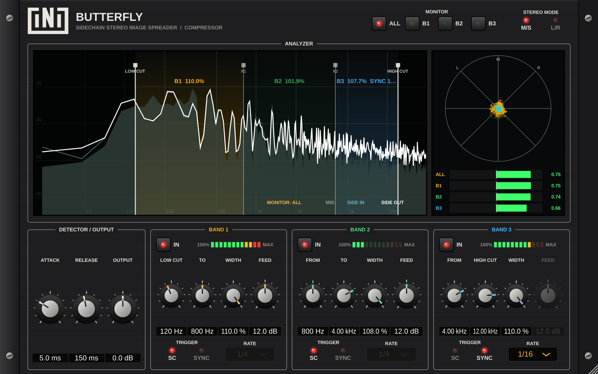

# Butterfly Compressor: User Manual
*by iNi, version 1.0*

---

## 1. What is Butterfly?

A normal sidechain compressor **ducks the volume** of a sound when another sound plays (the classic "pumping" kick and bass).

**Butterfly ducks the stereo width instead, in reverse.** When the trigger hits, the chosen frequencies **spread wider** (up to 110%), then glide back to normal. Think of a butterfly opening its wings on every hit.

Use it to:
- make pads, synths or reverbs **bloom wider** after every kick or snare;
- widen only the **highs** of a bus in time with the hi-hats, while the low end stays mono and solid;
- add **rhythmic stereo movement** to a static sound with tempo sync, no sidechain needed.

Everything below **Low Cut** and above **High Cut** passes through untouched, so your sub and the very top end stay exactly as they were.

---

## 2. Installing

| | |
|---|---|
| **Mac** | Open `ButterflyCompressor-Mac.pkg`. On the *Installation Type* page choose **VST3**, **AU** and/or **Standalone App**. If macOS blocks it: right-click the .pkg → **Open** → **Open**. |
| **Windows** | Run `ButterflyCompressor-Windows-Setup.exe`. The VST3 goes to `C:\Program Files\Common Files\VST3`. If SmartScreen warns: **More info → Run anyway**. |

Restart or rescan plugins in your DAW. The plugin appears as **iNi → Butterfly Compressor**.

---

## 3. Quick start (60 seconds)

### A. With a sidechain (e.g. kick → pad)
1. Put Butterfly on the **pad** track (a stereo track).
2. Route the **kick** to Butterfly's **sidechain input** (see §8 for your DAW).
3. Leave all bands on **TRIGGER: SC**.
4. Play. On every kick the bands glow, the **spread LEDs** light up and the pad opens wider.
5. Not enough movement? Turn up **FEED**. Too jumpy? Raise **RELEASE**.

### B. Without a sidechain (tempo sync)
1. Put Butterfly on any stereo track.
2. On a band, switch **TRIGGER** to **SYNC** and pick a **RATE**, e.g. **1/4**.
3. Press play. The band pulses wide on every quarter note, locked to your song.

---

## 4. The front panel



```
┌──────────────────────────────────────────────────────────────────────┐
│ [iNi] BUTTERFLY        NO SIDECHAIN   MONITOR [ALL][B1][B2][B3]  M/S L/R │
├──────────────────────────── ANALYZER ────────────────────────────────┤
│  Spectrum with draggable LOW CUT / X1 / X2 / HIGH CUT  │ Goniometer   │
│                                                        │ Phase meters │
├─ DETECTOR / OUTPUT ─┬──── BAND 1 ────┬──── BAND 2 ────┬──── BAND 3 ───┤
│ ATTACK RELEASE OUT  │ IN  spread LEDs│ ...            │ ...           │
│                     │ FROM TO WIDTH FEED                              │
│                     │ TRIGGER SC/SYNC   RATE                          │
└─────────────────────┴────────────────────────────────────────────────┘
```

### 4.1 Header
| Control | What it does |
|---|---|
| **NO SIDECHAIN** | Lights up when a band is set to SC but nothing is routed to the sidechain input. |
| **MONITOR: ALL / B1 / B2 / B3** | Chooses what the analyser and goniometer show. **ALL** shows every band at once, each in its colour (B1 amber, B2 green, B3 blue). **B1–B3** show one band only. This changes the display only, not the sound. |
| **STEREO MODE: M/S / L/R** | How the widening is done (see §5). |

### 4.2 Analyser
- **Spectrum:**
  - grey fill = Mid;
  - thin blue line = Side **before** Butterfly;
  - bright line = Side **after** Butterfly.
  - When the plugin is working, the bright line rises above the blue one. That is the widening you're adding.
- **Band areas:** they glow when triggered, and each shows its live width, e.g. `B2 107.3%`, plus `SYNC 1/8` if synced.
- **Draggable lines:** grab **LOW CUT**, **X1**, **X2** or **HIGH CUT** with the mouse to move the band edges.
- **Goniometer** (right): a vertical line = mono, a wide cloud = stereo, a horizontal line = out of phase.
- **Phase meters ALL / B1 / B2 / B3:** always visible.
  - **+1** = mono, fully in phase;
  - **0** = very wide;
  - **below 0 (red)** = out of phase. Parts of the sound will cancel on mono playback (phones, clubs). Keep them green or amber.

### 4.3 Detector / Output
| Knob | Range | What it does |
|---|---|---|
| **ATTACK** | 0.1 – 100 ms | How fast the width opens when triggered. Short = snappy, long = blooming. |
| **RELEASE** | 10 – 1000 ms | How fast it returns to 100% afterwards. |
| **OUTPUT** | −12 – +12 dB | Final output level. |

### 4.4 Each band (1, 2, 3)
| Control | What it does |
|---|---|
| **IN** | Turns the band on or off. A band that is off stays at a normal 100% width. |
| **Spread LEDs** | Show how far the band is currently pushed from 100% toward its WIDTH setting. |
| **FROM / TO** | The band's frequency range. Band 1 FROM = **Low Cut**, Band 3 TO = **High Cut**. Neighbouring bands share an edge, so there are never gaps or overlaps. |
| **WIDTH** (0 – 110%) | How wide the band gets when fully triggered. **100%** = no change, **110%** = maximum spread, **below 100%** = it *narrows* on the hit instead. |
| **FEED** (−12 – +36 dB) | Sensitivity to the sidechain. More feed = quieter hits still trigger the full width. Greyed out in SYNC mode. |
| **TRIGGER: SC / SYNC** | **SC** = follows its slice of the sidechain. **SYNC** = pulses with the DAW tempo. |
| **RATE** (1/64 – 1/1) | Note value for SYNC mode. |

---

## 5. M/S vs L/R mode

| Mode | How it works | Good for |
|---|---|---|
| **M/S** | Leaves the Mid alone and turns the Side up. Width and loudness grow slightly together. | The most obvious, "bigger" effect. |
| **L/R** | Changes the left/right balance of the band so the overall level stays about the same while the image widens. | Mix buses and masters, where you don't want level jumps. |

---

## 6. How SYNC works
On each note division the band jumps toward its **WIDTH**, then curves back to 100% just before the next one. **ATTACK** and **RELEASE** still smooth that movement.

It follows your DAW's song position, so 1/4 hits exactly on the beats. When the transport is stopped, it keeps pulsing at the project tempo so you can dial it in.

You can mix modes. For example, Band 1 can follow the kick on **SC** while Band 3 pulses at **1/16 SYNC**.

---

## 7. Tips
- **Keep the low end mono:** set **Low Cut** around 120–200 Hz. Bass wider than that rarely translates.
- **Watch the phase meters:** if a band goes red, lower its **WIDTH** or switch to **L/R** mode.
- **Use MONITOR B1/B2/B3** to check one band's stereo image on its own.
- **Reverb/delay returns** are a great place for Butterfly: the tail widens between hits.
- **Narrow on the hit:** set WIDTH below 100% to focus a sound in the centre when the kick plays, then release wide.

---

## 8. Routing the sidechain in your DAW
| DAW | How |
|---|---|
| **Ableton Live** | On Butterfly, open the sidechain section (▼ arrow) and pick the trigger track in *Audio From*. |
| **Logic Pro** | Click the **Side Chain** menu at the top of the plugin window and choose the trigger track. |
| **FL Studio** | On the trigger track's mixer insert, right-click the arrow to Butterfly's track → *Sidechain to this track*. In Butterfly's wrapper, set the input to that sidechain. |
| **Cubase / Nuendo** | Enable **Side-Chain** on the plugin, then send the trigger track to *Butterfly – Side-Chain*. |
| **Reaper** | Route the trigger track to channels **3/4** of Butterfly's track, and set Butterfly's pins to use 3/4 as sidechain. |
| **Studio One** | Click the sidechain button in the plugin header and add the trigger track's send. |
| **Bitwig** | In the plugin's device panel choose a sidechain source. |

No sidechain in your DAW? Use **SYNC** mode.

---

## 9. Troubleshooting
| Problem | Fix |
|---|---|
| Nothing happens | Is a band on **SC** with no sidechain (NO SIDECHAIN lit)? Route one, or switch to SYNC. Is **WIDTH** at 100%? Is the band **IN**? |
| Plugin not in the DAW | Rescan plugins. On Mac with Logic, restart Logic after installing. |
| Mac: "can't be opened" | Right-click the .pkg → Open. |
| Sound gets thin in mono | Phase meter is red. Lower WIDTH, use L/R mode, or raise Low Cut. |

---
*Butterfly Compressor © iNi*
