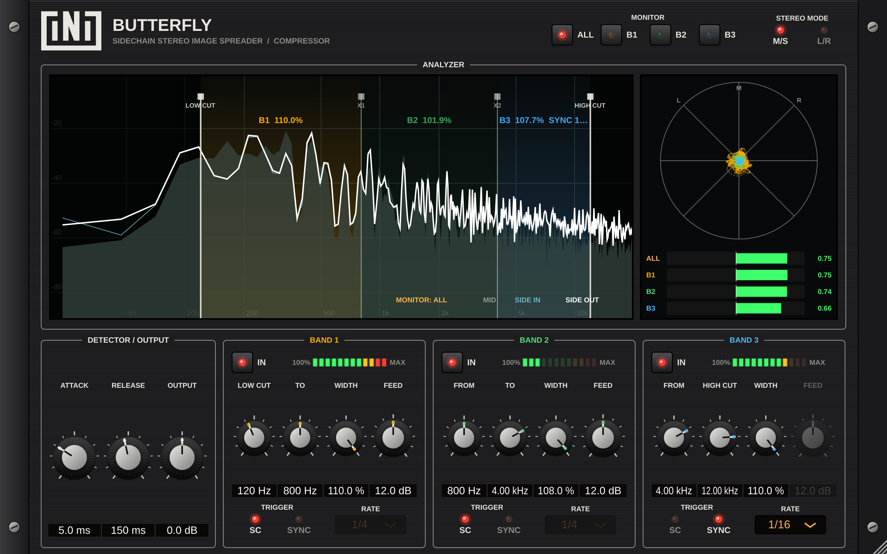

<p align="center"><b>iNi</b> presents</p>

# 🦋 Butterfly Compressor

**A multiband stereo-width "compressor" that is triggered by a sidechain or by your DAW's tempo.**

Instead of turning the volume down when the kick hits, Butterfly **opens up the stereo image** of the frequencies you choose, up to **110%** width, then lets it fall back to normal. Your mix breathes in width instead of volume.



---

## ⬇️ Download

| | Installer | What it installs |
|---|---|---|
| 🍎 **Mac** (Apple Silicon & Intel, macOS 11+) | **[Download ButterflyCompressor-Mac.pkg](https://github.com/fredchicoine/ButterflyCompressor/releases/latest/download/ButterflyCompressor-Mac.pkg)** | VST3, AU (Logic / GarageBand), Standalone app |
| 🪟 **Windows** (64-bit, Windows 10/11) | **[Download ButterflyCompressor-Windows-Setup.exe](https://github.com/fredchicoine/ButterflyCompressor/releases/latest/download/ButterflyCompressor-Windows-Setup.exe)** | VST3, Standalone app |

All versions: **[Releases page](https://github.com/fredchicoine/ButterflyCompressor/releases)**

**Installing**
- **Mac:** open the `.pkg`, then tick the formats you want. If macOS says it can't verify the developer, **right-click the .pkg → Open → Open**.
- **Windows:** run the Setup. If SmartScreen appears, click **More info → Run anyway**.
- Then **rescan plugins** in your DAW. You'll find it as **iNi → Butterfly Compressor**.

📖 **[Read the User Manual](MANUAL.md)**

---

## What it does, in one picture

```
            LOW CUT        X1             X2         HIGH CUT
  untouched    |   BAND 1   |    BAND 2    |   BAND 3   |   untouched
  ─────────────┼────────────┼──────────────┼────────────┼──────────────
               │  width ↑   │   width ↑    │  width ↑   │
               │ triggered by sidechain or tempo sync   │
```

- **Up to 3 bands**, each with its own frequency range, width target, trigger source and on/off switch.
- **Sidechain trigger:** each band listens to its own slice of the sidechain. For example, a kick widens only the lows.
- **Sync trigger:** no sidechain needed. The band pulses wide on every 1/64 to 1/1 note, locked to your DAW's tempo (Kickstart-style).
- **M/S or L/R** widening mode.
- **Phase-safe display:** spectrum analyser, goniometer and 4 phase-correlation meters (whole mix + each band), so you always know if you're going out of phase.
- Rack-style interface. Mac & PC, VST3 / AU / Standalone.

---

## For developers
Built with JUCE 8 + CMake.
```
cmake -B build -DCMAKE_BUILD_TYPE=Release
cmake --build build --config Release
```
Every push to `main` builds both installers on GitHub Actions and updates the release (`.github/workflows/build.yml`).
